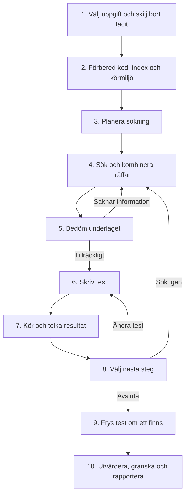

# Beslutskarta — vad vi bygger och varför

**Mål:** från en SWE-bench-buggrapport skapa ett test som avslöjar buggen före fixen och passerar efter fixen.
Agenten skriver testet. SWE-bench tillhandahåller referensfixen för separat utvärdering.

Här betyder **nod ett arbetssteg**. [Studio-demot](STUDIO.md) visar stegen som riktiga LangGraph-noder.
SWE-bench-körningen använder tills vidare den befintliga Python-loopen.
Detta beskriver nuvarande byggval och deras syfte. Modellval och budgetar är startvärden som återstår att utvärdera.

## Flödet att förstå först

Diagrammet visar agentic-läget. Budgetstopp kan avbryta tidigare. Ett fryst test är sparat, inte automatiskt lyckat.

## Förberedelser — före agenten

### 1. Välj uppgift och skilj bort facit

- **Val:** SWE-bench Lite, 5 dev- och 10 testuppgifter med reproducerbart urval. Agenten får buggrapport, repo och exakt kodversion före fixen. Fixen sparas separat.
- **Varför här:** bestäm uppgiften och informationsgränsen innan något blir sökbart. Annars riskerar modellen att få svaret i sitt underlag.
- **Ut:** publik uppgift och separat facit. Kod: [data.py](rag_regression/data.py).

### 2. Förbered kod, index och körmiljö

- **Val:** hämta exakt kodversion. Dela främst vid funktioner/klasser; spara fil, rader och version med varje kodbit. Bygg lokalt JSON-index med ordsökning och embeddings, alltså text representerad som tal. Lås en bestämd Docker-image.
- **Varför här:** agenten behöver sökbart material och en reproducerbar testmiljö innan den börjar. Metadata visar var träffarna kommer ifrån. JSON räcker för första implementationen utan en databasserver.
- **Ut:** sökindex och körmiljö. Kod: [retrieval.py](rag_regression/retrieval.py), [runner.py](rag_regression/runner.py).

## Agentloopen — en agent, flera steg

### 3. Planera sökning — Multi-Query, Routing och Query Construction

- **Val:** modellen formulerar kompletterande frågor, väljer kod/tester/dokumentation och eventuellt filfilter. Högst tre frågor används. Repo och version är låsta av programmet.
- **Varför här:** buggrapportens ord kan skilja sig från kodens namn. Planen riktar sökningen mot både beteendet och hur projektet brukar testa det.
- **Ut:** frågor och filter. Kod: `plan` i [model.py](rag_regression/model.py).

### 4. Sök och kombinera träffar — hybrid retrieval och RAG Fusion

- **Val:** BM25 söker på ord; embeddings söker via textlikhet. RRF kombinerar deras rangordningar och sedan de olika frågornas listor. Högst åtta kodbitar lämnas vidare.
- **Varför här:** exakta funktionsnamn och alternativa formuleringar kan komplettera varandra. Fusion väger samman placeringar utan att jämställa metodernas olika råpoäng.
- **Ut:** rankade kodbitar med källinformation. Kod: `Retriever.search` i [retrieval.py](rag_regression/retrieval.py).

### 5. Bedöm underlaget — vår CRAG-anpassning

- **Val:** modellen bedömer om träffarna räcker, vad som saknas och om något motsäger annat. Vid luckor kan den formulera nya frågor och återvända till sökningen.
- **Varför här:** att hitta rätt funktion räcker inte alltid. Vi kan fortfarande sakna importmönster, testförberedelser eller förväntat beteende.
- **Ut:** gå vidare eller sök igen. Kod: `assess` i [model.py](rag_regression/model.py), loopen i [agent.py](rag_regression/agent.py). Ingen fri webbsökning; detta är inte hela CRAG-artikelns implementation.

### 6. Skriv test — Generation

- **Val:** modellen får rapporten och sökträffarna och föreslår en ny `test_rag_regression.py`. Svaret måste följa ett bestämt JSON-format. Programmet kontrollerar filplacering och storlek.
- **Varför här:** genereringen behöver underlaget från sökningen. Ett bestämt svarsformat gör att programmet kan hantera resultatet. Befintlig produktionskod ska inte skrivas över.
- **Ut:** testkod, sökväg och förväntat fel. Kod: `generate` i [model.py](rag_regression/model.py), `validate_test` i [runner.py](rag_regression/runner.py).

### 7. Kör och tolka resultat

- **Val:** kör på kod före fixen i en ny Docker-container, utan nätverk eller API-nyckel. Registrera utförda testfall och skilj exempelvis importfel, testfel, godkänt resultat och miljöfel åt.
- **Varför här:** först efter verklig körning vet vi vad testet gjorde. Ett importfel visar inte att buggen fångats. En separat miljö begränsar testkodens påverkan på din dator.
- **Ut:** observationer och fullständig logg. Kod: [runner.py](rag_regression/runner.py) styr containern; [runtime.py](rag_regression/runtime.py) registrerar testerna inuti den.

### 8. Välj nästa steg — den agentiska återkopplingen

- **Val:** modellen väljer ny sökning, teständring, kandidat eller stopp. Kandidat kräver ett utfört testfel som modellen bedömer relevant.
- **Varför här:** nästa handling ska bero på observationen. Fel import kan kräva nya sökträffar; ett passerande test kan behöva andra indata för att utlösa buggen.
- **Ut:** nästa handling eller avslut. Kod: `decide` i [model.py](rag_regression/model.py) och [agent.py](rag_regression/agent.py). Kandidat är ännu inte bekräftad framgång.

## Avslut och utvärdering — facit kommer in först här

### 9. Frys testet

- **Val:** spara senaste giltiga test, kodversion och körmiljö med innehållshash, ett fingeravtryck som upptäcker ändringar.
- **Varför här:** testet måste vara bestämt innan facit används. Annars kan vi råka anpassa testet efter svaret och få en missvisande mätning.
- **Ut:** `frozen.json`, även om körningen inte hittade en kandidat. Kod: [agent.py](rag_regression/agent.py).

### 10. Utvärdera, granska och rapportera

- **Val:** kör samma frysta test i nya miljöer före och efter referensfixen. Kontrollera matchande test-ID:n. Du granskar sedan om testet verkligen provar den rapporterade buggen.
- **Varför sist:** fel före och godkänt efter visar en möjlig träff; granskningen avgör relevansen. Resultatet från fixad kod får inte skickas tillbaka till genereringen.
- **Ut:** bekräftad framgång först efter båda kontrollerna, annars redovisad osäkerhet/fel. Rapporten behåller alla valda uppgifter i nämnaren. Kod: [evaluation.py](rag_regression/evaluation.py).

## Beslut som gäller hela systemet

| Val | Varför och vad det innebär |
| --- | --- |
| En agent; LangGraph/Studio för insyn i demot | Noderna visar indata, utdata och nästa steg. CLI-flödet för SWE-bench finns kvar. Fyra slags modellfrågor betyder inte fyra agenter. |
| Luna via API; `text-embedding-3-small` för sökning | Konfigurerbara startval. Om Luna räcker jämfört med Terra är ännu inte mätt. |
| Begränsad loop | Högst 6 sökomgångar, 3 testversioner, 24 API-anrop, 100 000 tokens, 10 minuter och uppskattat $1 per generering. Motverkar obegränsad tid och kostnad; indexering har separat budget. |
| Baseline jämförs med agentic | Samma sökmetoder, men baseline har en sökomgång och en testversion, även vid svagt underlag. Vi mäter nyttan och kostnaden av hela återkopplingsloopen. |
| Loggar och offline-demo | Loggar förklarar vad som hände. Demots fasta svar låter oss kontrollera flödet utan API; de mäter inte modellens kvalitet. |
| ColBERT, RAPTOR och Multi Representation väntar | Börja med nuvarande metoder och se vilka problem som faktiskt återstår innan fler läggs till. |

## Vad behöver du kunna ta ställning till framöver?

1. **Hittar sökningen rätt material?** Inspektera träffarna innan vi väljer mer avancerad sökning.
2. **Räcker Luna?** Prova verkliga dev-uppgifter; jämför vid behov med Terra.
3. **Är extra försök värda kostnaden?** Jämför baseline och agentic på samma uppgifter.
4. **Provar testet rätt beteende?** Det är din relevansgranskning, inte bara en grön testkörning.

Offlineflödet och ett manuellt skrivet SWE-bench-kontrolltest är verifierade. Verkliga modellkörningar och hela jämförelsen återstår.
Detaljer finns i [kraven](requirements.md), [metodkartan](METHODS.md) och [körinstruktionerna](README.md).
