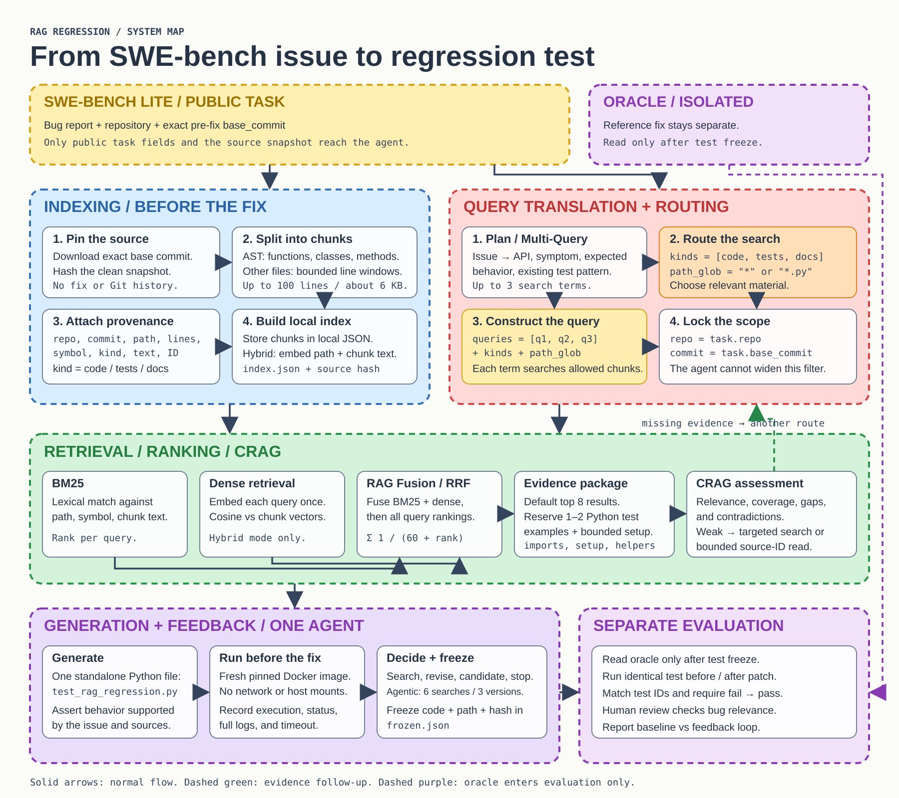

# RAG Regression Test Engineer

One agent creates regression tests for SWE-bench Lite bugs. It reads the issue and source at `base_commit`, retrieves relevant code, and writes a Python test. The test runs before the fix. A separate evaluator then runs **the same frozen test** before and after the reference fix.

[](assets/architecture.svg)

After a test run, the agent may search again, revise the test, or stop. The reference fix and fixed-version results stay outside test generation.

The local index stores chunks with `repo`, `commit`, `path`, line numbers, `symbol`, `kind`, and text. Hybrid mode adds embeddings. A search request contains up to three queries, source kinds, and one path filter:

```json
{
  "queries": ["reported symptom and API", "expected behavior", "existing test pattern"],
  "kinds": ["code", "tests", "docs"],
  "path_glob": "*"
}
```

The program fixes the repository and commit to the selected SWE-bench task. The diagram shows how BM25 and embeddings feed RRF ranking, how test examples get context, and how CRAG can request another search.

## What it does

1. **Read the issue.** SWE-bench Lite supplies a bug report, repository, and exact pre-fix commit. Public task data and the reference fix are stored separately.
2. **Retrieve evidence.** The project indexes code, existing tests, and documentation from that commit. Routing and query construction choose sources and filters. Multi-Query creates search terms; BM25, embeddings, and RAG Fusion rank the results.
3. **Check the evidence.** CRAG assesses relevance, coverage, and gaps. The agent can read more context, search again, or stop when evidence is insufficient.
4. **Write and run a test.** The agent proposes `test_rag_regression.py` and runs it in a fresh Docker container at the pre-fix commit. The result guides the next search, revision, or stop.
5. **Evaluate separately.** The test is frozen with a hash. The evaluator runs identical code before and after the fix. Human review checks whether the failure actually matches the issue.

## What kind of tests?

When the evidence is sufficient, the agent creates one standalone Python test file for a SWE-bench task. It follows evidenced APIs, setup, and test patterns from the target repository. The runner supports `pytest`, `unittest`, and Django tests.

Each test checks **observable behavior** from the issue: for example, a return value, a specified exception, or database behavior. The target is a test that fails because of the reported bug before the fix and passes after it. Import errors, environment failures, skipped tests, and tests that never execute do not count.

The agent does not write production fixes or use the reference fix to generate tests.

## Outputs

| Path | Contents |
| --- | --- |
| `data/` | Selected tasks, source at `base_commit`, search index, and a separate reference fix. |
| `runs/.../attempt-*/` | Proposed test file, execution evidence, result, and full log for each executed attempt. |
| `runs/.../frozen.json` | Frozen test code, path, commit, and integrity hash. |
| `runs/.../events.jsonl` and `summary.json` | Search and decision history, stop reason, and resource use. |
| `runs/.../evaluation/` | Before/after runs of the frozen test and review result. |

`data/`, `runs/`, and `.env` stay local and are ignored by Git. Raw test logs are kept locally for evaluation.

## Try the offline demo

The demo uses fixed model responses and a small synthetic bug. It checks the workflow, not model quality on SWE-bench. No API key or Docker is needed.

```sh
python3 -m rag_regression doctor
python3 -m rag_regression demo --out runs/demo-new
```

Read `runs/demo-new/report/report.md` afterward. Use a new output path for another run.

## Run a SWE-bench task

Requires Python 3.9+, Git, Docker, and `OPENAI_API_KEY` in a local `.env` or environment variable. The CLI uses Python's standard library. The default `config.json` uses GPT-6 Luna, `text-embedding-3-small`, and hybrid retrieval. Embedding indexing and generation make API calls.

```sh
python3 -m rag_regression dataset --split dev --count 5 --out data/dev
TASK=data/dev/public/INSTANCE_ID
python3 -m rag_regression prepare "$TASK"
python3 -m rag_regression image "$TASK"
python3 -m rag_regression index "$TASK"
python3 -m rag_regression run "$TASK" --mode agentic --out runs/pilot
python3 -m rag_regression evaluate runs/pilot --oracle data/dev/oracle/INSTANCE_ID.json
```

Replace `INSTANCE_ID` with an ID from `data/dev/selection.json`. The `image` step needs a compatible SWE-bench image; some tasks need a custom image for dependencies or test setup. Use `--mode baseline` for one search round and one test version. Budgets and retrieval settings are in `config.json`.

After evaluation, inspect `evaluation/before/output.log`, `evaluation/after/output.log`, and the test code. Record a reasoned verdict with `python3 -m rag_regression review ...`. A fail-to-pass transition remains preliminary until relevance is reviewed.

## Status

This is a learning project. One local dev round produced 10/10 technical fail-to-pass transitions: 5 baseline and 5 agentic. Human relevance review and the full comparison on the selected tasks remain open. This is not a general model success rate.

- [Methods and limitations](METHODS.md)
- [Decisions and workflow](DECISIONS.md)
- [Studio demo](STUDIO.md)
- [Requirements and remaining work](requirements.md)
